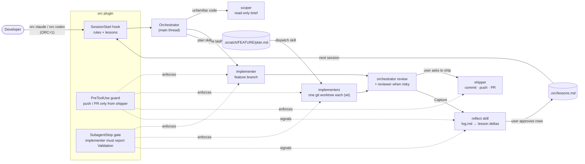

# Orchestra

[![npm][npm-badge]][npm] [![ci][ci-badge]][ci] [![coverage][cov-badge]](AGENTS.md#coverage-rule)

[npm-badge]: https://img.shields.io/npm/v/@crafts69guy/orchestra
[npm]: https://www.npmjs.com/package/@crafts69guy/orchestra
[ci-badge]: https://github.com/crafts69guy/orchestra/actions/workflows/ci.yml/badge.svg?branch=main
[ci]: https://github.com/crafts69guy/orchestra/actions/workflows/ci.yml
[cov-badge]: https://img.shields.io/badge/coverage-%E2%89%A598%25-brightgreen

Orchestra (plugin name `orc`) is a cross-harness orchestration workflow for Claude Code and
Codex. A main agent scopes, delegates, reviews and ships work through four specialised subagents
(`scoper`, `implementer`, `reviewer`, `shipper`), running independent tasks in parallel git
worktrees.

The rules are always-on but opt-in: they are injected at session start only when `ORC=1`.

## Architecture



- **One source, two harnesses.** Rules, agents and skills are Markdown; one set of Node hooks
  serves Claude Code and Codex. Codex agents are generated TOML, and `orc codex` injects the same
  context the hook does.
- **Soft rules, hard hooks.** The rules decide when to scope, delegate, plan and dispatch; the
  hooks enforce the few things that must never go wrong.
- **Parallel only when it pays.** `dispatch` runs only 2+ independent, substantial tasks in
  worktrees; small ones are batched into one implementer
  ([ADR-0006](docs/adr/0006-dispatch-threshold.md)).
- **Learns per repo.** Approved lessons are fed back into every later session; lessons about orc
  itself become rule edits only behind a failing-then-passing eval
  ([ADR-0013](docs/adr/0013-self-improvement-loop.md)).
- **Optional integrations:** Inkdrop feature notes, cocoindex-code semantic search, herdr pane
  workers.

Details: [docs/ARCHITECTURE.md](docs/ARCHITECTURE.md).

## Requirements

- Node.js 22.8 or newer (hooks and the CLI are plain Node scripts, zero runtime dependencies).
- [worktrunk](https://worktrunk.dev) (`brew install worktrunk`) for parallel dispatch. The
  session hook warns when `wt` is missing.
- Claude Code and/or Codex.
- Optional: [cocoindex-code](https://github.com/cocoindex-io/cocoindex-code) (`uv tool install 'cocoindex-code[full]'`)
  for semantic code search. orc never installs it.
- Claude Code: the `ponytail` plugin is declared as a dependency. Add its marketplace first:
  `/plugin marketplace add DietrichGebert/ponytail`.

## Install

Install the `orc` CLI, then let it check everything else:

```sh
npm i -g @crafts69guy/orchestra
orc doctor
```

`orc doctor` prints one line per check with a fix hint for each failure, and exits 1 if a
required check fails. Install the plugin for your harness as it suggests:

Claude Code:

```text
/plugin marketplace add crafts69guy/orchestra
/plugin install orc@orchestra
```

Codex:

```sh
codex plugin marketplace add crafts69guy/orchestra
codex plugin add orc@orchestra
```

## Usage

| Command | Does |
|---|---|
| `orc doctor [--json]` | checks Node, git, `wt`, the harness CLIs and the installed plugins |
| `orc status [--json]` | one line per plan task (`.scratch/<feature>/plan.md`) with its worktree, pane agent state and report status |
| `orc inkdrop init\|inbox\|claim\|push\|pull\|lessons ...` | mirrors a feature into an Inkdrop note, and lessons into notes of their own (Inkdrop, below) |
| `orc context [--scope user\|project\|all] [--json]` | audits what Claude Code and Codex load into context (memory, skills, agents, plugins, MCP): token estimates and findings |
| `orc claude [--yolo] [--level high] [--panes] [--wt <branch> [--base <ref>]] [args...]` | starts `claude` with `ORC=1` and `--model opus` (unless you pass `--model`) |
| `orc codex [--yolo] [--wt <branch> [--base <ref>]] [args...]` | starts `codex` with `ORC=1` and the orchestration context (below) |
| `orc update` | updates the npm CLI, then the plugin for each harness that has the `orchestra` marketplace (`claude plugin update orc@orchestra`, `codex plugin marketplace upgrade orchestra`); skips npm from a git checkout |
| `orc ccc init [--force]` | indexes this repo with `ccc` for semantic search (repos under 200 files need `--force`) |
| `orc wt new\|merge\|remove\|list ...` | worktree helper used by the `dispatch` skill (`remove` abandons a task: worktree and branch); prints JSON |
| `orc wt session <branch> [--base <ref>] [--yes]` | creates or reuses a session worktree for `<branch>` (`--base` applies only to a new branch); prints `{branch, path, action}` |
| `orc pane start <F> <T> --path <wt> --brief <file>`, `wait\|prompt\|close <T> --path <wt> ...` | herdr pane workers for the `dispatch` skill (pane mode, below); prints JSON |
| `orc eval [args...]` | behaviour evals; only from a git checkout (see [AGENTS.md](AGENTS.md)) |
| `orc --help`, `orc --version` | usage and version |

`orc status --json`, `orc doctor --json` and `orc context --json` are a versioned contract
(`schemaVersion`) for external clients such as a Raycast extension; see
[ADR-0010](docs/adr/0010-json-contract-for-external-clients.md).

`--yolo` turns off permission prompts for that run (`--dangerously-skip-permissions` on Claude,
`--dangerously-bypass-approvals-and-sandbox` on Codex). Without it the harness keeps its normal
permission model. Other arguments pass through to the harness, and so does its exit code.

`orc claude` only sets `ORC=1`; `ORC=1 claude` works too. Without `ORC=1` the hooks exit
silently and the session is untouched.

The handoff brief to `implementer` includes a Docs/JSDoc acceptance criterion (new or changed exports
carry JSDoc, touched docs are updated). `ORC_DOCS=0` turns it off; any other value keeps it on.

When `ccc` is on `PATH` and the repo's git root is indexed (`orc ccc init`), `orc claude` and
`orc codex` add the `cocoindex-code` MCP server for that run. `ORC_CCC=0` turns it off; any other
value keeps it on. A repo indexed mid-session needs a restart.

`orc claude --level high` (or `ORC_LEVEL=high`) raises the subagent models for that session, Claude
Code only: `implementer` runs on opus, `scoper` and `shipper` on sonnet, `reviewer` is unchanged, and
so is the orchestrator's own model. `--level default` (or no flag) keeps the agents' own models.

`orc claude --panes` (or `ORC_PANES=1`) turns on pane mode when the session runs inside
[herdr](https://herdr.dev) (`HERDR_ENV=1`): `dispatch` runs each implementer as a real `claude` or
`codex` session in a herdr pane of an `orc:<feature>` tab, inside its worktree, so you can watch
and step into each one. Workers write their report to `<worktree>/.orc/report.md` (git-excluded).
Outside herdr the flag has no effect. See [ADR-0009](docs/adr/0009-herdr-pane-workers.md).

Run one orchestrator session per checkout. `orc claude --wt <branch>` (or `orc codex --wt
<branch>`) starts the session in its own session worktree, created by `orc wt session` from
`--base` when the branch is new, at the path your worktrunk template gives (by default a sibling
`<repo>.<branch>`). Plans stay in the main checkout's `.scratch/`. When a session starts in a
checkout that another herdr agent is working in, or (outside herdr) that already has uncommitted
changes, the context warns it not to touch them and to isolate itself. See
[ADR-0012](docs/adr/0012-session-worktrees.md).

orc learns per repo. When a feature is done, the `reflect` skill proposes changes to the main
checkout's `.orc/lessons.md` (git-excluded), such as a new lesson or a vote on an old one, and
applies only the rows you approve. Every later session, on Claude Code and Codex, gets the 40
best-scored lessons after the rules. Lessons about orc itself can be promoted into its rules, but
only behind a new eval case that fails first. See
[ADR-0013](docs/adr/0013-self-improvement-loop.md).

## Inkdrop

Optional: share each feature with [Inkdrop](https://www.inkdrop.app) as one note. Turn on the
local server (Preferences → Local Server) and export the same variables the Inkdrop MCP server
uses. In fish, put them in an untracked file such as `~/.config/fish/conf.d/inkdrop.local.fish`:

```fish
set -gx INKDROP_LOCAL_SERVER_URL http://localhost:19840   # optional; loopback hosts only
set -gx INKDROP_LOCAL_USERNAME <username>
set -gx INKDROP_LOCAL_PASSWORD <password>
```

Don't use `set -U` if your dotfiles track `fish_variables`: the password would end up in the
repo. Then map the repo to a notebook (default: the repo directory name, matched
case-insensitively; `--create` makes it) and create the `orc` tag:

```sh
orc inkdrop init [--book <name>] [--create]
```

Five flows, each driven by the orchestrator once the session context names the notebook:

- **Inbox:** write a note tagged `orc` with status `active`; `orc inkdrop inbox` lists it and
  `orc inkdrop claim <note-id> <feature>` turns it into the request.
- **Mirror:** `orc inkdrop push <feature>` writes a managed block (decisions, a checkbox per task,
  merges checked) below your text, and `orc wt merge` pushes again. `orc inkdrop pull <feature>`
  reports whether you edited the spec.
- **Capture:** `orc inkdrop push <feature> --done` adds `.scratch/<feature>/log.md` and marks the
  note completed.
- **Recall:** with the Inkdrop MCP server connected, the orchestrator and `scoper` search the
  notebook before scoping.
- **Lessons:** `orc inkdrop lessons` writes each active lesson in `.orc/lessons.md` to its own
  note tagged `orc-lesson` and marks removed ones `dropped`, so recall finds them from other
  repos.

orc only rewrites its own block and never deletes. A note whose markers are damaged (an
unterminated begin, two blocks) is refused, never guessed at: fix it in Inkdrop. `orc doctor`
checks the server. `ORC_INKDROP=0` turns the integration off (no rule lines, no notebook in the
context, no push after `orc wt merge`; merges are still recorded for `orc status`); any other
value keeps it on. See [ADR-0011](docs/adr/0011-inkdrop-feature-note.md).

Verify once, with Inkdrop running:

1. `orc doctor` shows `✓ inkdrop` with the notebook.
2. `orc inkdrop claim <note-id> demo`, then `orc inkdrop push demo`.
3. Edit the spec in Inkdrop; `orc inkdrop pull demo` shows `changed: yes`.
4. Inkdrop's preview hides the `<!-- orc:begin -->` and `<!-- orc:end -->` markers.

## Codex

Codex does not trust project agents or plugin hooks by default, so `orc codex` runs `codex`
with `ORC=1` and prepends, per run and without touching `~/.codex`:

- `-c developer_instructions=...`: the same context the SessionStart hook injects (rules, the
  absolute path of `orc`, `wt` warning).
- `-c agents.<name>.config_file=...` and `.description=...` for each `codex/agents/*.toml`.
- `--add-dir <git common dir>` inside a git repo, because `workspace-write` blocks `.git` and
  worktrees and commits need it.

It exits 1 if the rules file is missing and 127 if `codex` is not on `PATH`.

## Docs

- [Architecture](docs/ARCHITECTURE.md)
- [Research notes](docs/research/)
- [Contributing and dev commands](AGENTS.md)

## License

MIT
