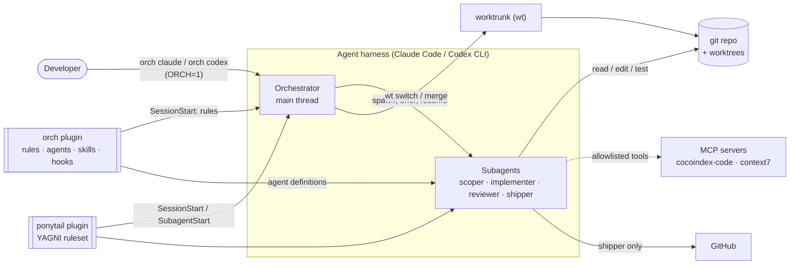
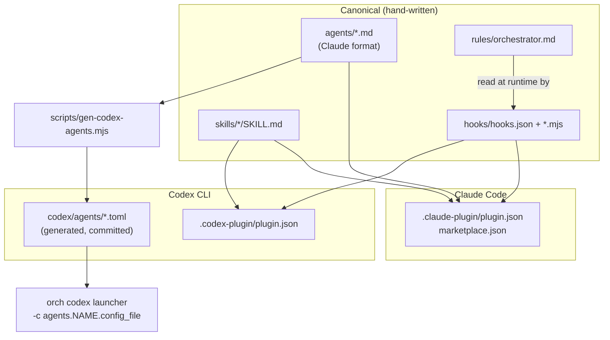
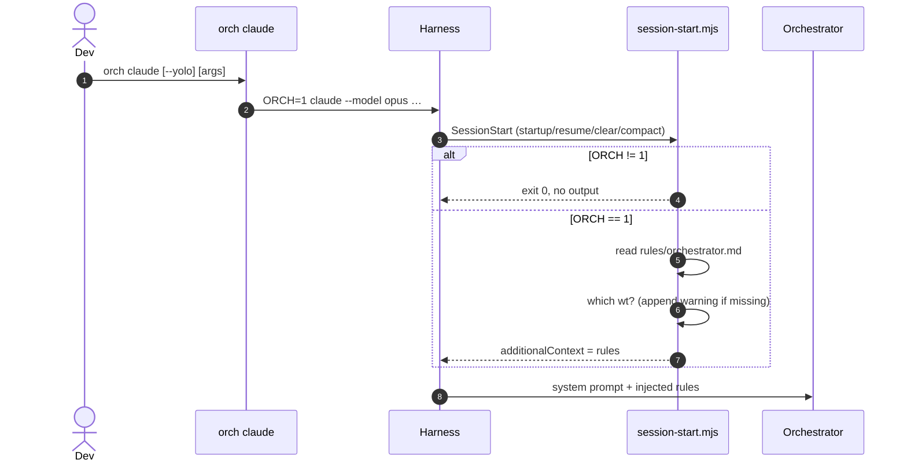
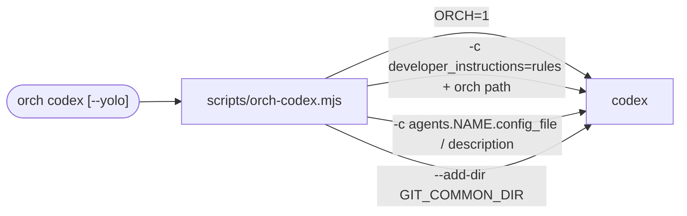
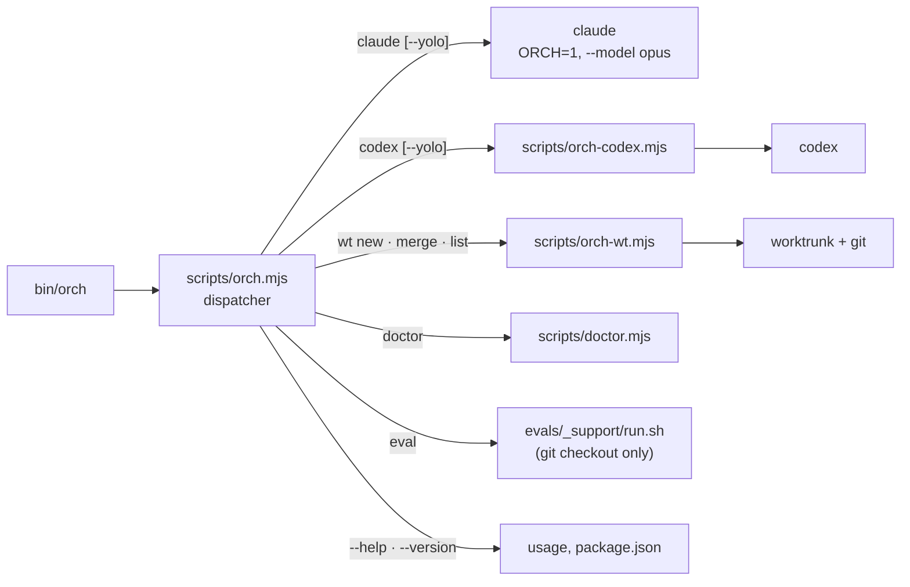
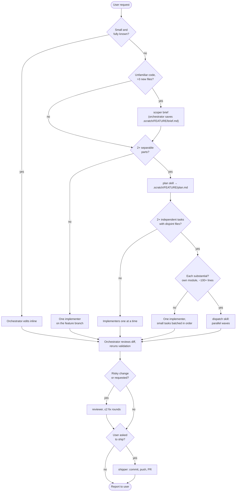
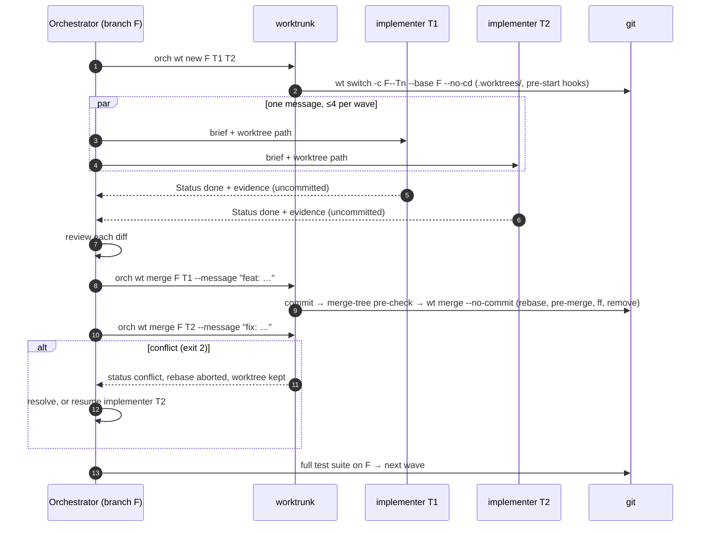
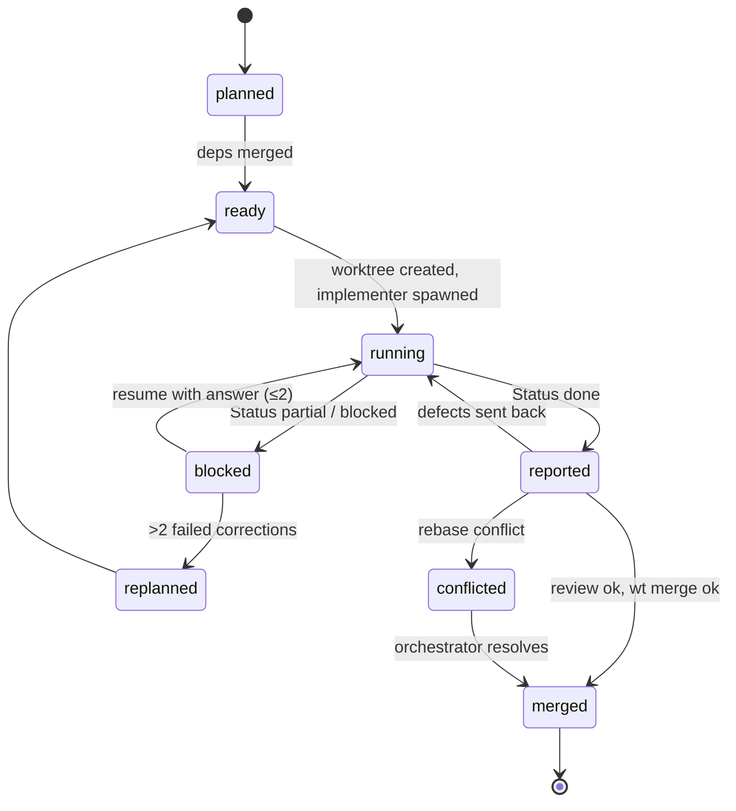
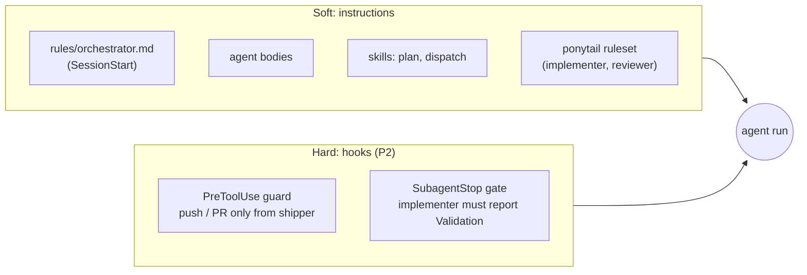

# Architecture

Orchestra (`orch`) turns a coding agent session into an **orchestrator** that
delegates token-heavy work to role-specific **subagents**, and runs independent
implementation tasks **in parallel**, each in its own git worktree.

One repository serves several agent harnesses. Phase 1 targets **Claude Code**
and **Codex CLI**; opencode and others come later through the same adapter seam.

- Decisions: [`docs/adr/`](adr/)
- Evidence behind the decisions: [`docs/research/`](research/)

## 1. Goals and non-goals

| Goals | Non-goals |
|---|---|
| One source of truth for roles, rules and skills across harnesses | A GUI, kanban board or TUI |
| Opt-in per session (`ORCH=1`), invisible otherwise | Replacing the harness's own planning or permission model |
| Parallel implementers on disjoint tasks, merged one at a time | Parallel writers on the same checkout |
| Enforcement by hooks where prompts are not enough | Agent teams / peer-to-peer agent chat (experimental, skipped) |
| Fully tested glue code (≥98% coverage), linted and formatted | Runtime dependencies beyond Node and worktrunk |

## 2. System context



## 3. Repository layout: source of truth and adapters

Canonical content is written once. Each harness reads it directly where formats
agree and through a generated adapter where they do not.



```text
orchestra/
├── .claude-plugin/{plugin.json, marketplace.json}
├── .codex-plugin/plugin.json
├── agents/{implementer,scoper,reviewer,shipper}.md   # canonical roles
├── codex/agents/*.toml          # generated; CI fails when stale
├── rules/orchestrator.md        # always-on orchestration rules
├── skills/
│   ├── plan/SKILL.md            # plan.md schema
│   └── dispatch/                # waves, worktrees, spawn, merge
│       ├── SKILL.md
│       └── references/{claude,codex}.md
├── hooks/
│   ├── hooks.json               # shared by both harnesses
│   ├── session-start.mjs        # ORCH gate, rules injection, wt check
│   ├── guard.mjs                # PreToolUse: push/PR only from shipper
│   └── subagent-stop.mjs        # implementer evidence gate
├── bin/orch                     # CLI entry (npm bin): claude, codex, wt, doctor, eval
├── scripts/
│   ├── orch.mjs                 # subcommand dispatcher, `orch claude`
│   ├── orch-wt.mjs              # `orch wt`: worktrunk wrapper used by dispatch
│   ├── orch-codex.mjs           # `orch codex`: rules, agents, sandbox dirs
│   ├── doctor.mjs               # `orch doctor`: prerequisite checks
│   └── gen-codex-agents.mjs, lib/
├── test/                        # node:test, ≥98% coverage
├── evals/                       # claude plugin eval suites
└── docs/{ARCHITECTURE.md, adr/, research/}
```

## 4. Activation

The plugin is installed and enabled globally, but stays inert unless the
session was started with `ORCH=1` ([ADR-0003](adr/0003-env-gated-activation.md)).



Re-injection on `compact` keeps the rules alive after context compaction.

The context ends with the absolute path of `orch`, so agents can call
`orch wt` even where the plugin's `bin/` is not on `PATH`.

On Codex, hooks only run after the user trusts them, so `orch codex`
carries the same context without hooks:



## 5. CLI

`orch` is one Node entry point (`bin/orch`), shipped as the npm package
`@crafts69guy/orchestra` and inside the plugin
([ADR-0005](adr/0005-orch-cli.md)). It replaces the old `bin/orch-wt` and
`bin/orch-codex` shims and the dotfiles' `cyl --wf` / `cdx --wf` wrappers.



| Command | Does |
|---|---|
| `orch claude [--yolo] [args]` | runs `claude` with `ORCH=1`; adds `--model opus` unless `--model` is given; `--yolo` → `--dangerously-skip-permissions` |
| `orch codex [--yolo] [args]` | Codex launcher (§4); `--yolo` → `--dangerously-bypass-approvals-and-sandbox` |
| `orch wt new\|merge\|list` | worktree helper for dispatch (§8) |
| `orch doctor` | checks node, git, `wt`, a harness and the installed plugins; exit 1 if a required check fails |
| `orch eval [args]` | behaviour evals; exits 1 when `evals/` is absent (npm install) |

Exit codes pass through from the child (a signal becomes 1); a missing
`claude` or `codex` binary exits 127. Permission bypass is never the default.

## 6. Roles

| Role | Model / effort | Tools | Writes? | Notes |
|---|---|---|---|---|
| **Orchestrator** | Opus (session model) | all | small, fully known edits | owns scope, architecture, merges, conflicts |
| **scoper** | Haiku / low, 30 turns | Read, Grep, Glob, Bash, ToolSearch, `cocoindex-code` search | no (`disallowedTools: Write, Edit`) | returns a brief with file citations |
| **implementer** | Sonnet / medium | Read, Write, Edit, Grep, Glob, Bash | yes, in its assigned checkout only | never commits; reports status + evidence |
| **reviewer** | Opus / high | Read, Grep, Glob, Bash | no | fresh context; correctness pass then ponytail over-engineering pass |
| **shipper** | Haiku / low, 15 turns | Read, Bash | git only | commit, push, PR; only after review and user approval |

Every role has an explicit `tools:` allowlist because subagents otherwise inherit
every MCP tool and skill of the parent. Models are pinned so cheap roles never
inherit Opus.

Plugin-shipped Claude agents ignore `permissionMode`, `hooks` and `mcpServers`,
and Codex agents have no per-agent tool allowlist (only `sandbox_mode`). Hard
guarantees therefore live in plugin hooks (§9), not in agent frontmatter.

## 7. Orchestration lifecycle



### Plan contract

`plan.md` is the shared state between orchestrator and workers. Each task:

```yaml
- id: T2
  goal: Parse the new config key and expose it on Settings
  files: [src/config.ts, src/config.test.ts]   # ownership; must be disjoint within a wave
  depends_on: [T1]
  size: small                                   # or substantial: own module, ~100+ lines
  validate: pnpm test src/config
  decisions: [use zod schema, key name `retryLimit`]
```

The orchestrator computes waves from `depends_on`; tasks in one wave must have
disjoint `files`. Cross-cutting decisions are written into `decisions` before
dispatch so parallel workers never make conflicting implicit choices.

Only `substantial` tasks are dispatched, and only when 2+ of them are
independent; `small` tasks are batched into one implementer on the feature
branch. Parallel worktrees were no faster on tiny modules at +45% cost, and
21% faster on large ones at +22% cost
([benchmarks](research/benchmarks.md), [ADR-0006](adr/0006-dispatch-threshold.md)).

## 8. Parallel dispatch with worktrunk

Worktrees are created explicitly by the orchestrator through worktrunk on both
harnesses ([ADR-0002](adr/0002-worktrunk-for-worktrees.md)). Native Claude
`isolation: worktree` is not used: Codex has no equivalent, the branch hand-back
is undocumented, and its default base is the default branch rather than the
feature branch.



Result: one squashed commit per task on `F`; the shipper only pushes and opens
the PR.

### `orch wt` (verified in P0)

`orch wt` (`scripts/orch-wt.mjs`) wraps worktrunk so the agent never composes
these by hand. The SessionStart hook prints the absolute path of `orch`, which
works on both harnesses.

| Command | Does |
|---|---|
| `orch wt new <F> <T>… [--yes]` | ignores `.worktrees/` via `.git/info/exclude`, then `wt --config-set 'worktree-path=".worktrees/{{ branch \| sanitize }}"' switch -c <F>--<T> --base <F> --no-cd --format=json`; prints `[{task, branch, path}]` |
| `orch wt merge <F> <T> --message <msg> [--yes]` | commits with the orchestrator's message (squashing extra commits), pre-checks with `git merge-tree --write-tree`, then `wt merge <F> --no-commit`; prints `merged` with the commit, or `conflict` with files (exit 2, rebase aborted) |
| `orch wt list <F>` | prints `[{task, branch, path}]` for the worktrees whose branch is `<F>--<task>` |

Design notes from P0:

- `worktree-path` is ignored in project `.config/wt.toml`, so it is passed per
  call; the user's global worktrunk config is never written.
- Without a TTY and without `--yes`, `wt` refuses to run project hooks, so
  `--yes` is passed only after the user confirms the repo is trusted.
- worktrunk's fallback squash message is not conventional, so the orchestrator
  always writes the message.

### Task state machine



## 9. Enforcement layers

Prompts set intent; hooks guarantee the few things that must never go wrong.



Codex requires the user to trust plugin hooks first, so the skills restate the
critical rules instead of relying on hooks alone.

## 10. Harness adapter matrix

| Capability | Claude Code | Codex CLI | Orchestra approach |
|---|---|---|---|
| Plugin manifest | `.claude-plugin/plugin.json` | `.codex-plugin/plugin.json` (also reads Claude's) | ship both |
| Agents in plugin | `agents/*.md` | not supported | generate TOML; `orch codex` passes `-c agents.<n>.config_file=…` |
| Agent addressing | `orch:<role>` (bare name not found) | bare `<role>`; unknown name silently falls back | rules name both forms |
| Spawn | Agent tool, parallel in one message | `spawn_agent` + `wait_agent`, only when told | dispatch skill + per-harness reference |
| Per-agent tools | `tools` / `disallowedTools` | `sandbox_mode` only | allowlists on Claude, read-only sandbox on Codex |
| Session context | SessionStart `additionalContext` | same contract, hooks need trust | one `hooks.json` |
| Worktree per subagent | `isolation: worktree` | none; sandbox blocks `.git` writes | worktrunk on both; Codex adds `--add-dir <repo>/.git` |
| `agent_type` in hooks | `orch:<role>` | `<role>` | hooks strip the `<plugin>:` prefix |
| Plugin dependencies | `dependencies` | none | ponytail declared on Claude, documented on Codex |

## 11. Quality strategy

| Gate | Tool | Threshold |
|---|---|---|
| Unit tests | `node --test` | all pass |
| Coverage | Node built-in coverage | ≥98% lines, branches, functions; `test/**` excluded only |
| Lint + format (JS/JSON) | Biome | no diagnostics |
| Lint (Markdown) | markdownlint-cli2 | no diagnostics |
| Plugin manifest | `claude plugin validate .` | passes |
| Generated adapters | `gen-codex-agents --check` (P3) | no diff |
| Behaviour | `npm run eval` / `orch eval` (`claude plugin eval`, manual, costs money) | delegate / don't-delegate / batch / parallel cases beat baseline |
| Benchmark | `npm run eval:bench` (`bench-modules` and the break-even probe `bench-large`, outcome graders only incl. hidden tests; manual, about $3 and $5 per full run; [results](research/benchmarks.md)) | reported, not gated: score, wall-clock and cost Δ vs baseline |

Hook scripts are small exported pure functions behind a thin `main`, so
coverage reflects real logic rather than exclusions.

## 12. P0 verification and roadmap

All open questions were tested against real CLIs on 2026-10-12
([evidence](research/p0-findings.md)).

| ID | Result | Consequence |
|---|---|---|
| W1–W5 | pass | `orch wt` command shapes above |
| C1 | pass with `-c agents.<n>.config_file` (or a trusted project) | no Codex install step |
| C2 | fails by default | Codex launcher adds `--add-dir <repo>/.git` |
| C3 | partial: hooks need trust (or `--dangerously-bypass-hook-trust`) | skills and agent TOMLs restate critical rules |
| K1 | pass, needs `ToolSearch` alongside MCP tools | kept in scoper's allowlist |
| K2 | pass, `agent_type` = `orch:<role>` incl. PreToolUse in subagents | per-role guard hook |
| K3 | pass, one retry with `stop_hook_active` | implementer evidence gate |
| K4 | pass with prefix only | rules use `orch:<role>` on Claude |

| Phase | Scope | State |
|---|---|---|
| P0 | Verify the questions above | done |
| P1 | Tooling, manifests, agents, rules, SessionStart hook | done |
| P2 | `plan` + `dispatch` skills, worktree helper (now `orch wt`), guard and gate hooks | done |
| P3 | Codex adapter: generator, launcher (now `orch codex`) | done |
| P4 | Evals, `claude plugin tag`, public release | done (v0.2.0) |
| P5 | Unified `orch` CLI (`orch claude \| codex \| wt \| doctor \| eval`), npm package; dotfiles drop the `--wf` wrappers ([#1](https://github.com/crafts69guy/orchestra/issues/1)) | done (v0.3.0) |
| P6 | Benchmarks (`bench-modules`, `bench-large`), dispatch threshold by task size ([ADR-0006](adr/0006-dispatch-threshold.md)), `batch-small` / `parallel-dispatch` evals | done (v0.4.0) |
